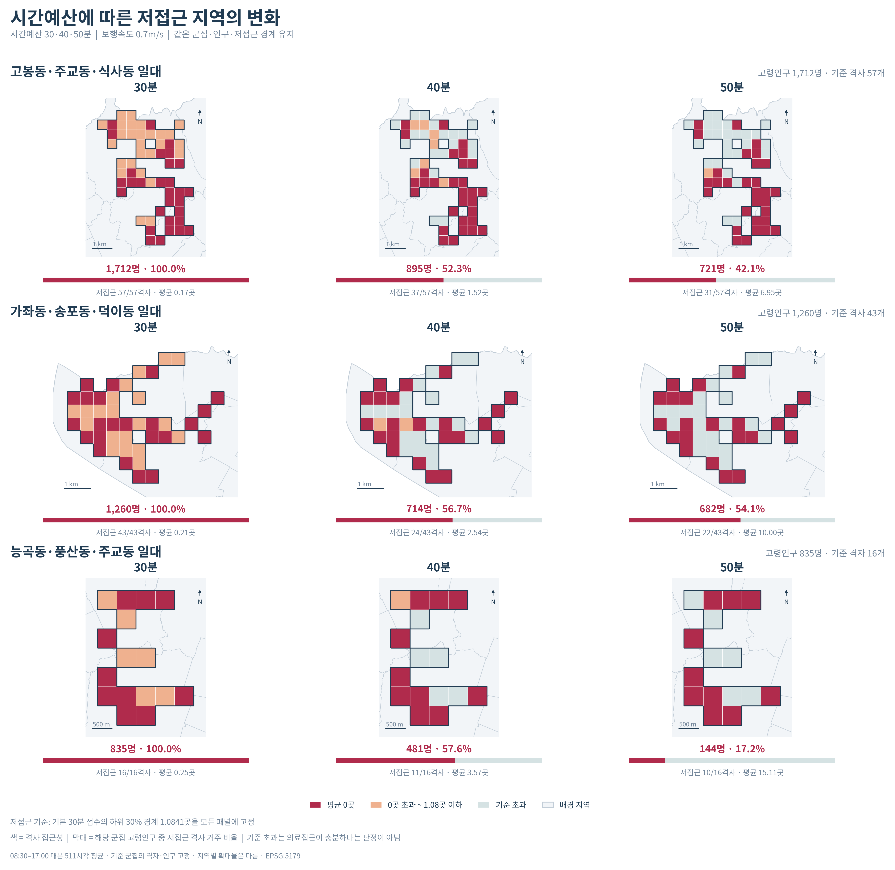

# 고양시 고령자의 대중교통 의료접근성 분석

고양시 고령자가 대중교통으로 의료기관에 접근할 수 있는 정도를 분석하는 프로젝트다. 접근성이 낮은 지역 중 고령인구가 많이 거주하는 군집을 선정하고, 보행·대기·환승에 따른 이동부담을 살펴본다.

## 결과 보고서와 주요 결과

분석 완료 후 `outputs/결과_보기.html`을 웹 브라우저에서 열면 전체 지도와 결과표를 확인할 수 있다. 보고서를 옮길 때는 `step01`~`step09` 폴더를 포함한 `outputs` 폴더 전체를 함께 둔다.

**의료접근성과 고령인구 상위 저접근 군집**


**시간예산 30·40·50분에 따른 대표 군집 비교**



[AI 대시보드 바로가기](https://goyang-medical-dashboard.onrender.com)

## 분석 개요

| 항목 | 내용 |
| --- | --- |
| 대상 | 고양시 65세 이상 고령인구 |
| 공간 단위 | 250m 격자에서 계산하고, 고령인구로 가중평균하여 500m 격자로 집계 |
| 의료기관 | 고양시와 인접 경기 4개 시·서울 8개 구의 내과 또는 정형외과 전문의가 있는 의료기관 |
| 접근성 지표 | 08:30~17:00 매분 출발 기준, 30분 이내 도달 가능한 의료기관 수의 평균 |
| 이동 조건 | 보행속도 0.7m/s, 연속보행 최대 10분, 환승 최대 2회 |
| 분석 대상 군집 | 접근성 하위 30% 격자를 Queen 인접으로 묶고, 고령인구 합계가 큰 상위 3개 군집 선정 |

분석은 자료 준비 → 이동경로 계산 → 접근성 집계 → 저접근 군집 진단 순서로 진행한다. 시간예산·보행속도·저접근 기준을 바꾼 민감도 분석도 함께 수행한다.

## 프로젝트 구조

```text
goyang-senior-mobility/
├─ README.md
├─ run.py                 # v7 분석 실행과 자동 재개
├─ requirements.txt       # 패키지 목록
├─ preprocess/            # 데이터 전처리
├─ steps/                 # Step 1~9 분석
├─ src/                   # 공통 함수
├─ overrides/             # 기존 확정 판정·원본 ID·도형 CSV·056 보완 입력
├─ data/
│  ├─ manifest.json       # 파일별 SHA-256·출처·스키마·재배포 조건
│  ├─ raw/                # 원자료
│  └─ processed/          # 전처리 자료
├─ assets/fonts/          # 한글 글꼴과 OFL 라이선스
├─ tests/                 # 경로·집계·재개·휴대성 검증
├─ outputs/               # step01~step09, 결과_보기.html
└─ dashboard/             # AI 대시보드
```

## 데이터

분석 데이터는 **Google Drive**로 제공한다. 실행 방식에 맞는 자료를 내려받아 아래 경로에 배치한다.

**다운로드 링크:** 추후 추가

| 자료 | 배치 경로 | 용도 |
| --- | --- | --- |
| 원자료 | `data/raw/` | 전처리부터 전체 분석 실행 |
| 전처리 자료 | `data/processed/` | 전처리를 생략하고 분석 실행 |

## 실행환경

`run.py`와 Step 1~9가 구현되어 있다. 실제 계산 완료 여부는 `outputs/run_manifest.json`에서 확인한다.

프로젝트 폴더에서 실행환경을 구성한다.

```powershell
python -m venv .venv
$env:TMP = "$PWD/.tmp"
$env:TEMP = "$PWD/.tmp"
$env:PIP_CACHE_DIR = "$PWD/.cache/pip"
New-Item -ItemType Directory -Force .tmp, .cache/pip | Out-Null
.\.venv\Scripts\python.exe -m pip install -r requirements.txt
```

## 전체 분석 실행과 재개

전처리가 끝난 자료를 사용할 때:

```powershell
.\.venv\Scripts\python.exe run.py processed
```

원자료부터 전처리와 분석을 모두 수행할 때:

```powershell
.\.venv\Scripts\python.exe run.py raw
```

현재 분석은 `processed` 방식으로 진행한다. 이 방식은 raw를 읽거나 전처리 결과를 변경하지 않는다. 두 명령 모두 입력·보정 검사 → Step 1~9 → 결과표·GPKG·PNG까지 이어진다. 같은 명령을 다시 실행하면 지문과 완료 파일이 일치하는 계산을 재사용하고 미완료 출발점부터 계속한다. 실행 중에는 같은 프로젝트에서 두 분석 프로세스를 동시에 시작하지 않는다.

조건은 `run.py`의 `CONFIG` 한 곳에서 관리한다. 결과는 `outputs/step01`~`step09`에 저장하며 CSV는 각 단계의 `tables/`, PNG는 `figures/`에 모은다. GPKG는 Python 코드에서 생성한다. 공간 보정 원본은 `overrides/geometry_overrides.csv`다. 직접 편집한 GPKG를 보정 원본으로 사용하지 않는다.

출발점별 압축 경로와 계산 캐시는 중단 후 재개에 필요하다. 상세 경로 배열은 `.cache/analysis/`에 저장한다. outputs에 중복 derived 폴더를 만들지 않는다. `.cache/`가 없어도 processed와 보정으로 재계산할 수 있지만 계산 시간이 더 든다. 새 입력·설정·코드와 맞지 않는 캐시는 재사용하지 않는다.

## 전처리 코드

`data/raw/`와 `overrides/`를 프로젝트 내부에 배치한다. 의료기관 좌표는 저장된 카카오 응답으로 재현하므로 이 실행에는 API 키·네트워크가 필요하지 않다. 누락 응답이 있으면 오류로 알린다. 새 주소를 조회할 때만 루트의 정확한 `.env` 파일 또는 `KAKAO_API_KEY` 환경변수를 사용한다.

자료별 코드는 `preprocess/01_boundaries.py`부터 `07_gtfs_supplements.py`까지이며 단독 실행도 가능하다. 07은 06 결과가 필요하다. 전체 실행은 마지막에 보정 대상과 저장 결과를 검사하고 `data/manifest.json`을 갱신한다. MD·이미지는 전처리 코드에서 생성하지 않는다.

입력·출력·임시 파일·캐시는 프로젝트 내부에서 처리한다. 다른 폴더로 이동한 경우 `.venv`는 새 위치에서 다시 설치한다. 확정 판정은 `overrides/`에서 읽고 과거 결과 폴더나 검토 HTML을 입력으로 사용하지 않는다.

자료별 전처리 코드는 개발·검사용 내부 구성이다. 전체 연구 재현에는 위 두 가지 `run.py` 명령을 사용한다.

## 전처리 자료의 사용

- OSM은 길이와 통행 판정을 저장한다. 보행시간은 분석에서 시나리오 속도로 계산한다.
- GTFS는 최대 2회 환승·80분 진단을 수용하는 후보를 보존한다. GTX·고속철도·시외/고속버스·공항버스는 제외한다.
- 기존 056 보완 입력은 유지하며, 80편의 중간 정차 시각은 추정값으로 구분한다.
- 출입구·망 연결의 확정 보정 CSV는 Step 2~4에서 적용한다. 이미 processed에 적용된 건물·통행·좌표·056 시간표 보정은 중복 적용하지 않는다.

## 해석과 검토

주점수는 511개 출발시각의 30분 내 기관 수 평균이다. 접속 근거가 부족한 정류장을 가정상 이용할 수 있을 때 점수가 달라질 가능성이 있는지는 별도 영향 검사로 확인한다. 이 가상 연결은 실제 경로에 추가하지 않는다. 영향을 배제하지 못한 출발점은 0점 대신 미해결로 구분하며, 해당 자식의 원래 인구를 빼고 500m 점수를 재정규화하지 않는다.

주거 없는 유인구 격자의 잠정 중심점, 승인된 주소 도착점, 횡단보도·담장 근사는 각 결과의 상태·근거에 남긴다. 현장 검증을 완료했다는 뜻이 아니다. 056 보완 운행의 지선 중간 시각은 추정이며, 선택 경로에 사용되었는지를 Step 9에서 표시한다. 결과의 평일 프로필은 특정 날짜의 실측 운행이나 진료 가능 여부를 뜻하지 않는다.

정류장 접속은 `src/stop_access.py`에서 같은 도로·높이의 횡단부, 정류장 높이 근거, 역 이름과 거리 차이에 따른 출입구 배정을 처리한다. 중앙정류장의 기존 횡단부 탐색은 720m이며, 100m 초과 자체를 필수검토 사유로 쓰지 않는다. 채택한 접속거리·철도 내부 이동시간은 연속보행 비용에 포함한다.


## 그림과 보고서만 재생성

계산이 완료된 상태에서 표현만 변경할 때 사용한다. 저장된 OD·집계값을 사용하며 경로 탐색을 호출하지 않는다. 입력·계산 코드가 변경된 경우에는 이 명령을 중단하고 processed 실행을 요구한다.

```powershell
.\.venv\Scripts\python.exe run.py report
```

결과는 outputs/step01~step09에 바로 생성된다. PNG는 figures, CSV는 tables, 설명은 README.md에 저장한다. 기준 지도와 민감도 지도는 같은 분류·색·500m 집계 기준을 사용한다. 보고서는 분석 조건과 수치 해석을 중심으로 구성한다. 실행·보정 이력, 장소 검토 목록, 250m 내부 진단은 보고서 산출물이 아니다.

## tests와 계산 캐시

- tests/: 경로 계산, 집계, 재개 및 파일 이동을 검증하는 개발용 소스다. 결과 열람과 분석 실행에는 필수가 아니지만 코드 신뢰성 확인을 위해 보존한다.
- .cache/analysis/: 출발점별 상세 경로와 재개 자료다. 삭제해도 processed에서 재생성되지만 경로 계산 시간이 다시 든다. 빠른 재개와 report 실행을 위해 보존한다.
- 검증 실행: python -m unittest discover -s tests
