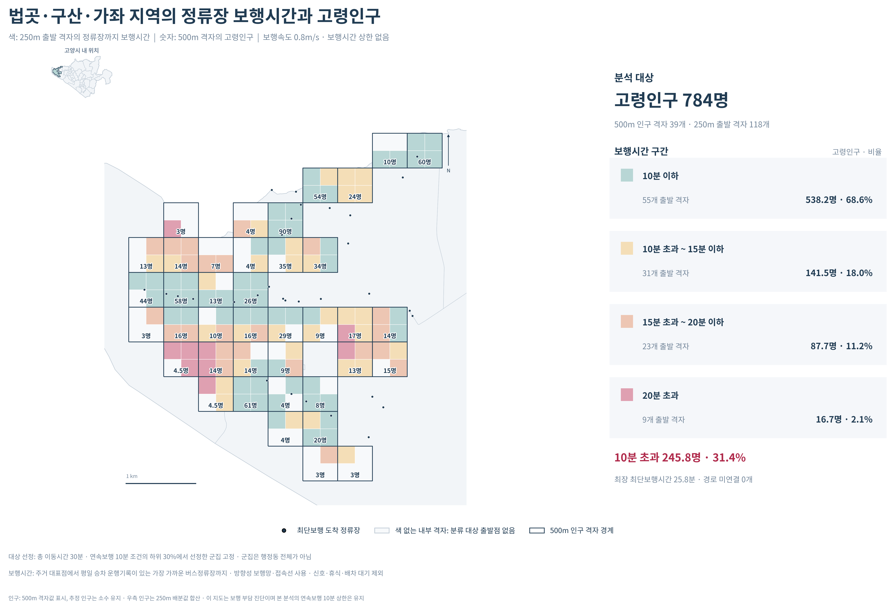

# 고양시 고령자의 대중교통 의료접근성 분석

고양시 고령자가 대중교통으로 의료기관에 접근할 수 있는 정도를 분석하는 프로젝트다. 접근성이 낮은 지역 중 고령인구가 많이 거주하는 군집을 선정하고, 보행·대기·환승에 따른 이동부담을 살펴본다.

## 분석 개요

| 항목 | 내용 |
| --- | --- |
| 대상 | 고양시 65세 이상 고령인구 |
| 공간 단위 | 250m 격자에서 계산하고, 고령인구로 가중평균하여 500m 격자로 집계 |
| 의료기관 | 고양시와 인접 경기 4개 시·서울 8개 구의 내과 또는 정형외과 전문의가 있는 의료기관 |
| 접근성 지표 | 08:30~17:00 매분 출발 기준, 30분 이내 도달 가능한 의료기관 수의 평균 |
| 이동 조건 | 보행속도 0.8m/s, 연속보행 최대 10분, 환승 최대 2회 |
| 분석 대상 군집 | 접근성 하위 30% 격자를 Queen 인접으로 묶고, 고령인구 합계가 큰 상위 3개 군집 선정 |

분석은 자료 준비 → 이동경로 계산 → 접근성 집계 → 저접근 군집 진단 순서로 진행한다. 시간예산·저접근 기준을 바꾼 민감도 분석도 함께 수행한다.

## 프로젝트 구조

```text
goyang-senior-mobility/
├─ README.md
├─ run.py                 # 분석 실행
├─ requirements.txt       # 패키지 목록
├─ preprocess/            # 데이터 전처리
├─ steps/                 # 단계별 분석
├─ src/                   # 공통 함수
├─ data/
│  ├─ manifest.json       # 제공 자료의 목록과 검증값
│  ├─ raw/                # 원자료
│  └─ processed/          # 전처리 자료
├─ outputs/               # 분석 결과 (png,csv,gpkg)
└─ dashboard/             # AI 대시보드
```

## 데이터

분석 데이터는 **Google Drive**로 제공한다. 실행 방식에 맞는 자료를 내려받아 아래 경로에 배치한다.

**다운로드 링크:** 추후 추가

| 자료 | 배치 경로 | 용도 |
| --- | --- | --- |
| 원자료 | `data/raw/` | 전처리부터 전체 분석 실행 |
| 전처리 자료 | `data/processed/` | 전처리를 생략하고 분석 실행 |
| 자료 명세 파일 | `data/manifest.json` | 제공 자료의 목록과 파일 검증값 확인 |

전처리 자료와 같은 배포본의 `manifest.json`을 함께 내려받아 위 경로에 배치한다. 
## 실행 방법

프로젝트 폴더에서 실행환경을 구성한다.

```powershell
python -m venv .venv
.\.venv\Scripts\python.exe -m pip install -r requirements.txt
```

실행 방식은 다음과 같다.

**1. 원자료부터 실행 (`raw`)**

원자료를 전처리한 뒤 전체 분석을 수행한다.

```powershell
.\.venv\Scripts\python.exe run.py raw
```

**2. 전처리 자료로 실행 (`processed`)**

제공된 전처리 자료를 사용해 분석부터 수행한다.

```powershell
.\.venv\Scripts\python.exe run.py processed
```

**3. 결과 보고서 재생성 (`report`)**

분석 완료 후 저장된 계산 결과를 사용해 그림과 HTML 보고서를 다시 생성한다. 경로 분석은 다시 수행하지 않는다.

```powershell
.\.venv\Scripts\python.exe run.py report
```

## 주요 결과

전체 결과는 분석 후 생성되는 `outputs/결과_보기.html`을 웹 브라우저에서 열어 확인할 수 있다.




## AI 대시보드

법곳·구산·가좌 지역의 의료이동·탄소 시나리오를 살펴보고, AI에 질문하며 계산 결과를 확인할 수 있다.

### [https://goyang-medical-dashboard.onrender.com](https://goyang-medical-dashboard.onrender.com)
