# 분석 결과

**고양시 고령자의 대중교통 의료접근성**

의료기관에 도달할 수 있는 기회의 공간적 차이를 살펴보고, 접근성이 낮으면서 고령인구가 집중된 지역의 이동부담을 분석합니다.

[분석 조건](#분석-조건) · [접근성·군집](#접근성과-고령인구-집중-지역) · [민감도](#민감도-분석) · [취약 원인](#취약-원인-진단) · [결과 자료](#단계별-결과-자료)

| 대상 고령인구 | 접근성 유효 격자 | 분석 의료기관 | 기준 저접근 군집 |
| ---: | ---: | ---: | ---: |
| **217,395명** | **874개** · 500m | **1,143곳** | **3개** |

## 분석 조건

| 항목 | 내용 |
| --- | --- |
| 지표 | 30분 이내 도달 가능한 의료기관 수의 평균 |
| 출발시각 | 08:30–17:00, 매분 511개 시각 |
| 공간 집계 | 250m에서 계산 → 고령인구 가중 500m 집계 |
| 이동 조건 | 0.8m/s · 연속보행 10분 · 최대 3회 탑승 |
| 교통수단 | 시내·마을버스, 도시철도 및 일반철도 |
| 군집 선정 | 하위 30%·경계 동점 포함 · Queen 인접 · 고령인구 상위 3개 |

고양시와 지정된 주변 지역의 내과 또는 정형외과 전문의가 있는 기관을 대상으로 합니다. 기관 수는 진료용량이나 진료시간까지 고려한 공급량은 아닙니다.

## 접근성과 고령인구 집중 지역

### 고양시 전체 의료접근성 점수

30분 이내 평균 도달 의료기관 수를 500m 격자별로 표시했습니다. 지도 아래 범례는 실제 점수 구간이며, 점수 산정 제외와 0곳을 구분합니다.

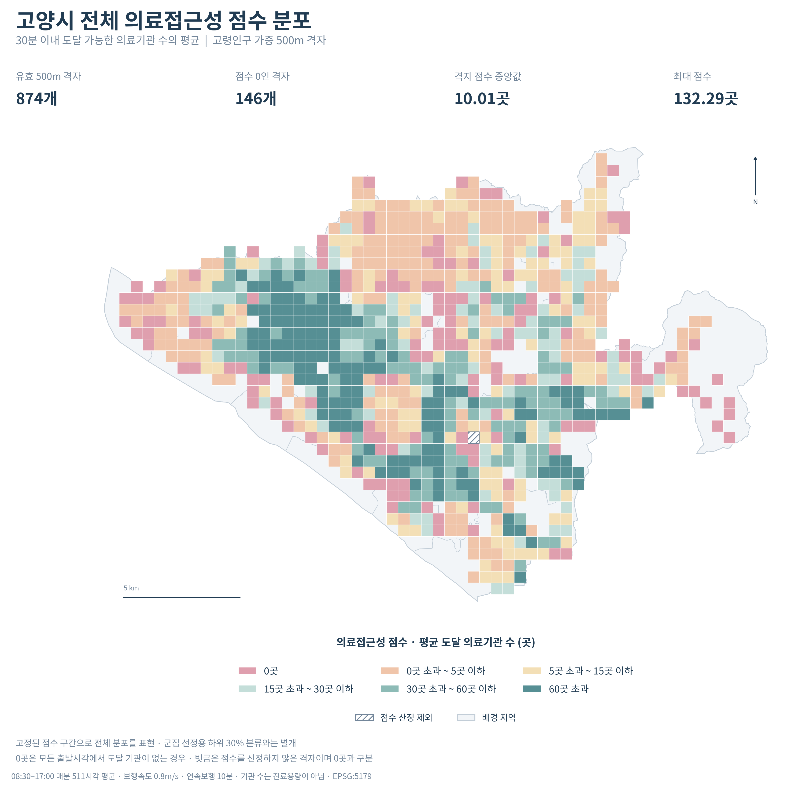

### 하위 30% 저접근 격자와 상위 3개 군집

하위 30% 격자 전체에서 고령인구가 많은 상위 3개 군집을 순위별 색과 윤곽으로 표시했습니다. 그 외 저접근 격자는 회색, 나머지 인구 격자는 연한 배경색으로 구분합니다.

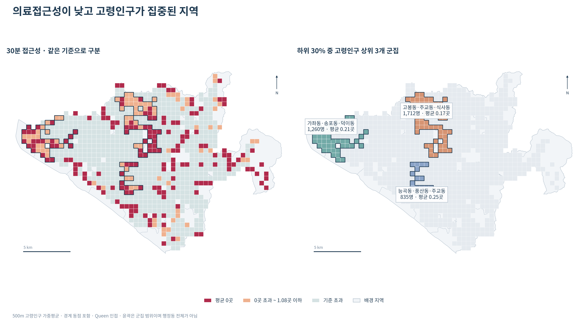

| 인구 순위 | 지역명 | 고령인구(명) | 평균 기관 수(곳) | 500m 격자 수 |
| ---: | --- | ---: | ---: | ---: |
| 1 | 고봉동·주교동·식사동 | 1,863.00 | 0.46 | 61 |
| 2 | 법곳·구산·가좌 지역 | 784.00 | 0.64 | 39 |
| 3 | 관산동·고양동 | 733.00 | 1.28 | 16 |

저접근 경계는 2.0084곳입니다. 군집명은 구성 지역을 설명하는 명칭이며 행정동 전체를 뜻하지 않습니다. 유효 점수의 고령인구 비중은 99.996%입니다.

## 민감도 분석

시간예산 비교는 기준 군집의 격자·인구를 고정합니다. 막대는 같은 군집에서 저접근 격자에 거주하는 고령인구 비율입니다.

### 시간예산 30·40·50분

저접근 경계를 고정해 평균 기관 수와 남아 있는 저접근 인구를 함께 비교합니다.

### 저접근 기준 하위 25·30·35%

전체 유효 격자에서 군집과 고령인구 순위를 다시 계산합니다.

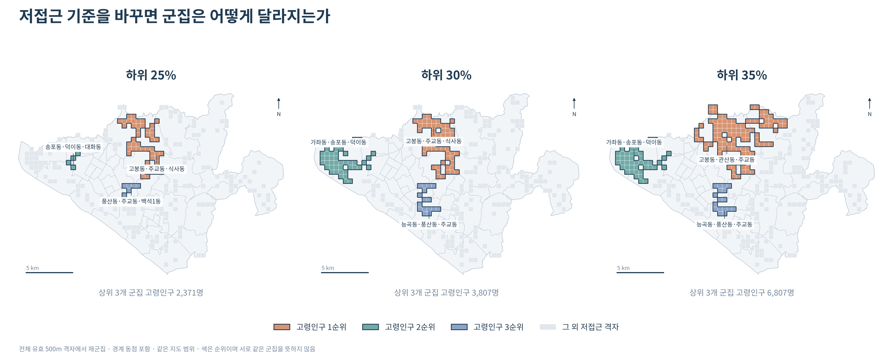

출발시각별 변화와 군집 중첩

### 출발시각별 평균 기관 수

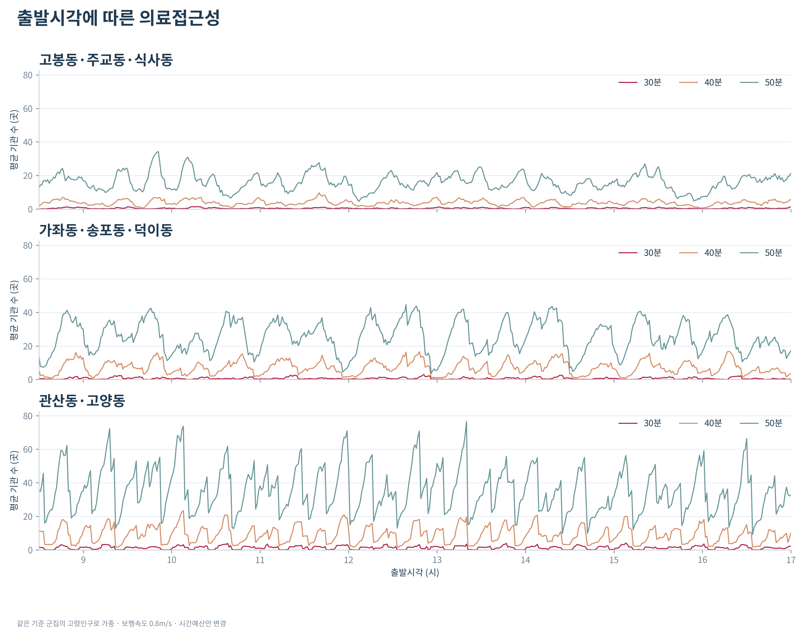

### 군집 선정 범위의 중첩

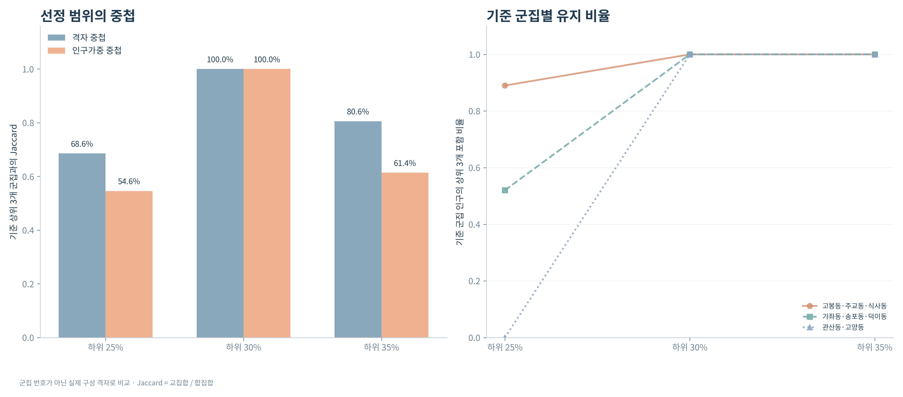

## 취약 원인 진단

전체 비율은 고령인구와 511개 출발시각을 가중한 값입니다. 첫 보행 불가와 운행·환승을 거친 미도달을 구분하고, 도달한 경로는 30분 이내와 초과로 나누어 비교합니다.

### 출발시각별 평균 대기시간

80분 내 의료기관에 도달한 출발 격자·시각의 경로를 대상으로 첫 탑승과 환승 대기를 합산했습니다. 출발시각은 30분 구간의 시작이며, 오른쪽 전체 평균은 전체 출발시각의 도달 경로를 고령인구로 가중한 값입니다. 연속보행 10분 조건을 유지하며 미도달을 0분으로 계산하지 않습니다. 시각별로 도달 경로 구성은 달라질 수 있습니다.

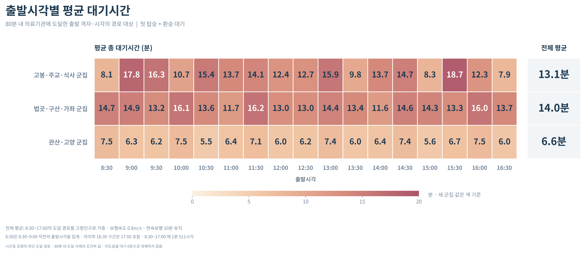

### 고봉·주교·식사 군집

#### 도달 상태와 시간 구성

80분은 진단 탐색 한도입니다. 두 도달 그룹의 시간 차이는 관측된 경로 차이이며 정책 효과 추정이 아닙니다.

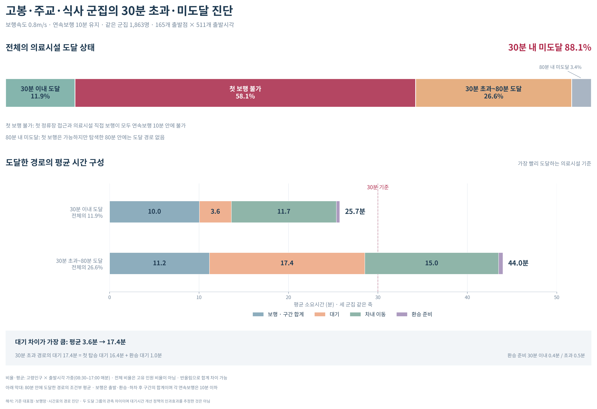

#### 정류장 보행시간과 고령인구

색은 250m 출발 격자의 최단 보행시간, 숫자는 500m 격자의 고령인구입니다. 이 지도만 보행시간 상한 없이 계산하며 본 분석의 연속보행 10분 조건은 유지합니다. 가까운 정류장이 곧 의료기관 도달에 유리한 정류장을 뜻하지는 않습니다.

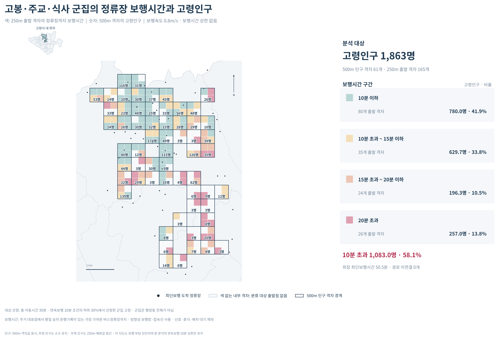

### 법곳·구산·가좌 지역

#### 도달 상태와 시간 구성

80분은 진단 탐색 한도입니다. 두 도달 그룹의 시간 차이는 관측된 경로 차이이며 정책 효과 추정이 아닙니다.

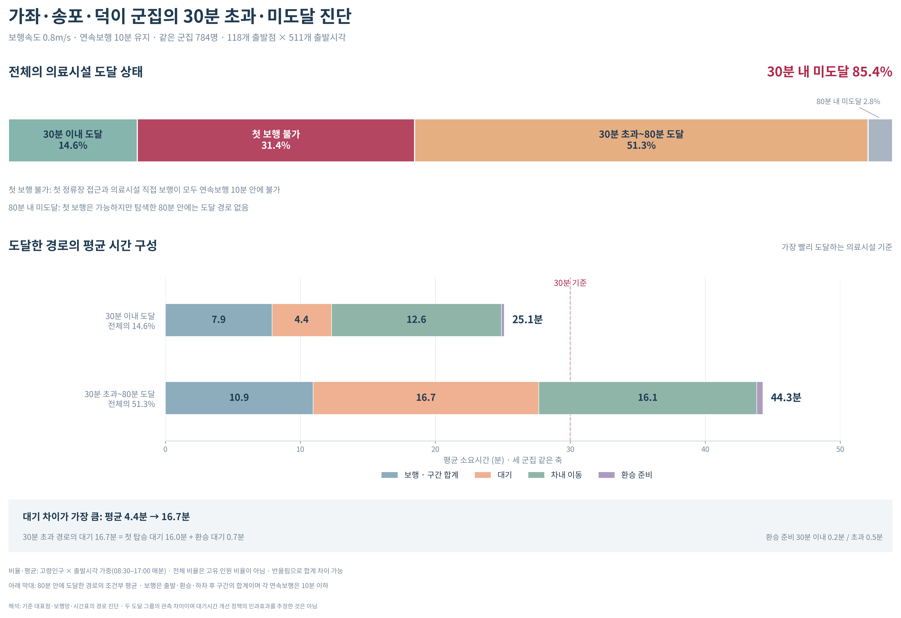

#### 정류장 보행시간과 고령인구

색은 250m 출발 격자의 최단 보행시간, 숫자는 500m 격자의 고령인구입니다. 이 지도만 보행시간 상한 없이 계산하며 본 분석의 연속보행 10분 조건은 유지합니다. 가까운 정류장이 곧 의료기관 도달에 유리한 정류장을 뜻하지는 않습니다.

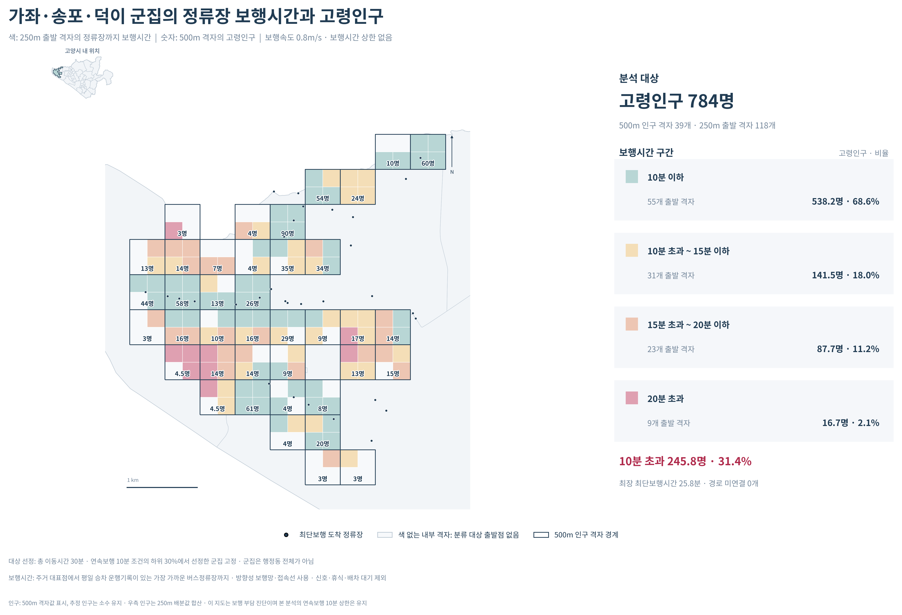

### 관산·고양 군집

#### 도달 상태와 시간 구성

80분은 진단 탐색 한도입니다. 두 도달 그룹의 시간 차이는 관측된 경로 차이이며 정책 효과 추정이 아닙니다.

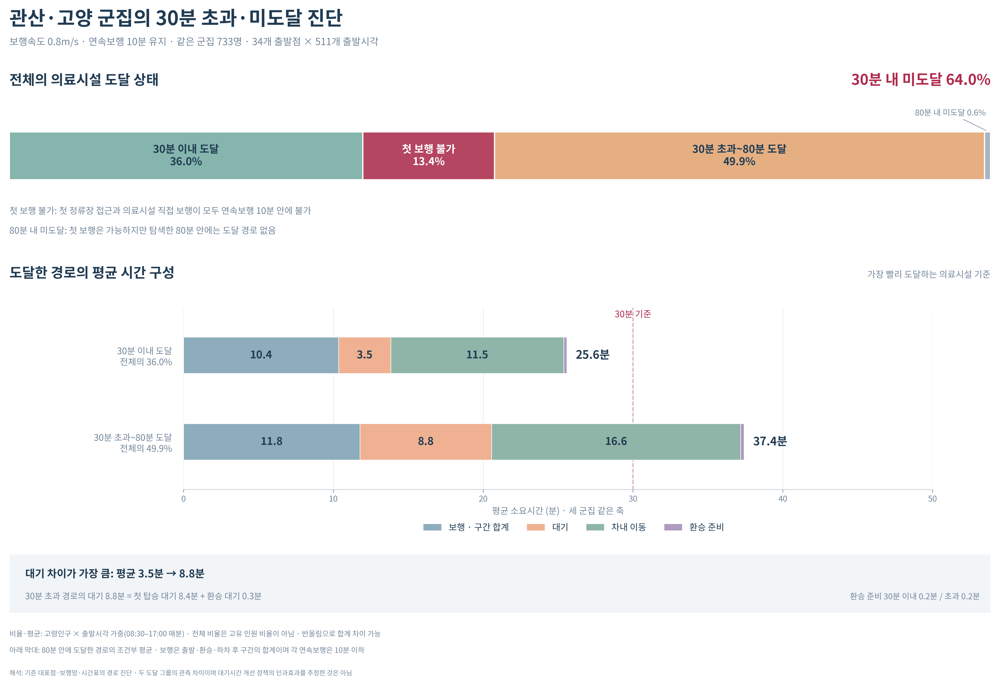

#### 정류장 보행시간과 고령인구

색은 250m 출발 격자의 최단 보행시간, 숫자는 500m 격자의 고령인구입니다. 이 지도만 보행시간 상한 없이 계산하며 본 분석의 연속보행 10분 조건은 유지합니다. 가까운 정류장이 곧 의료기관 도달에 유리한 정류장을 뜻하지는 않습니다.

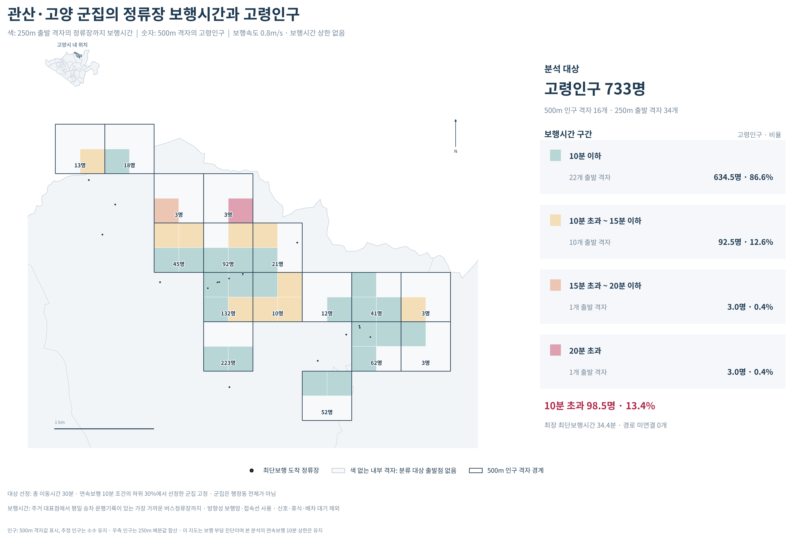

> 첫 정류장까지의 보행 부담과 도달 경로의 대기·차내 시간을 함께 살펴봅니다. 접속 위치의 근사와 일부 보완 시간표의 추정 시각은 자료상 한계입니다.

기초자료와 통합 교통망

### 고령인구 분포

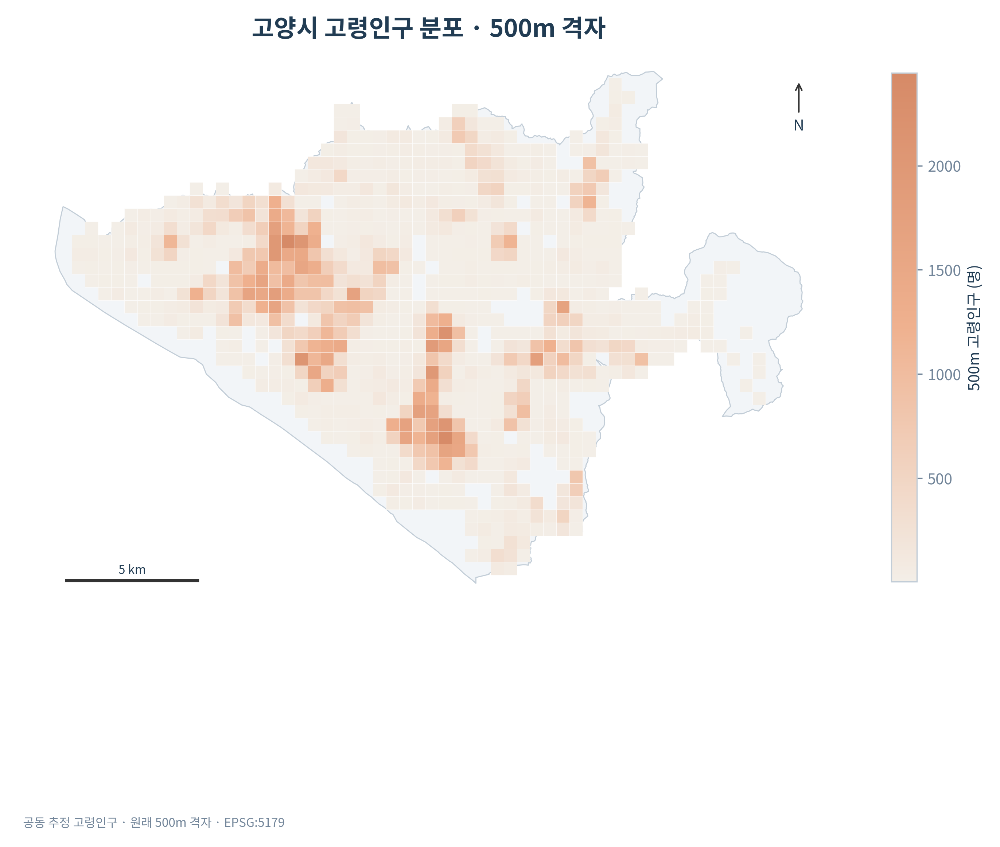

### 주거 대표점

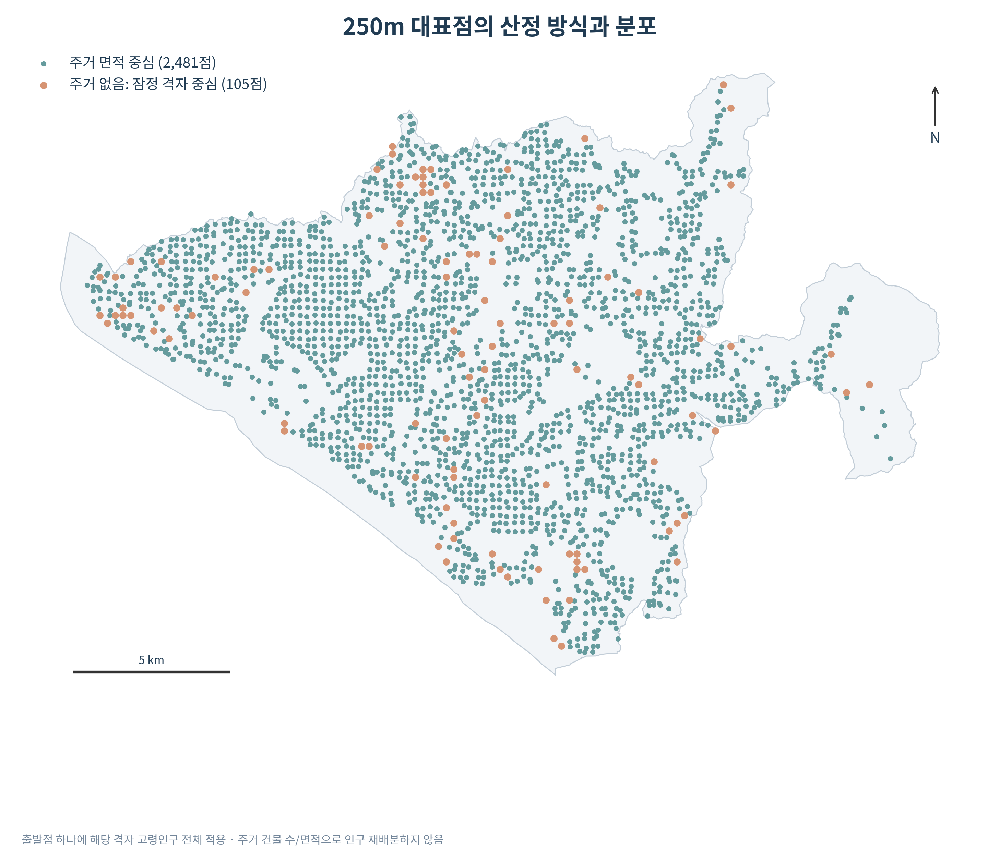

### 분석 의료기관

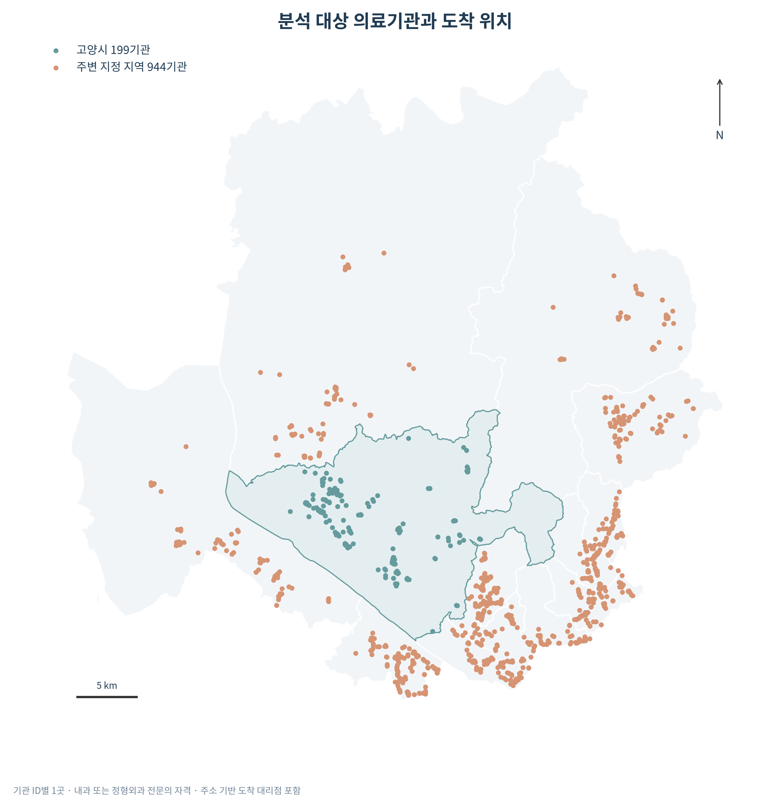

### 보행·정류장 통합망

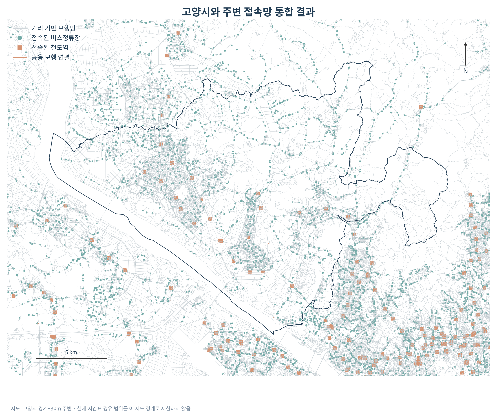

## 단계별 결과 자료

공간 결과는 GeoPackage, 수치는 CSV, 지도는 각 단계의 figures 폴더에 저장됩니다.

| 단계 | 분석 내용 | 파일·레이어 설명 | 공간 결과 |
| --- | --- | --- | --- |
| Step 1 | 인구와 가중치 | [설명 보기](step01/README.md) | [population.gpkg](step01/population.gpkg) |
| Step 2 | 주거 대표점과 보행 접속 | [설명 보기](step02/README.md) | [origins.gpkg](step02/origins.gpkg) |
| Step 3 | 의료기관과 도착점 | [설명 보기](step03/README.md) | [facilities.gpkg](step03/facilities.gpkg) |
| Step 4 | 정류장·철도·환승망 | [설명 보기](step04/README.md) | [network.gpkg](step04/network.gpkg) |
| Step 5 | 511개 출발시각 경로 | [설명 보기](step05/README.md) | — |
| Step 6 | 접근성 집계 | [설명 보기](step06/README.md) | [accessibility.gpkg](step06/accessibility.gpkg) |
| Step 7 | 저접근 군집 | [설명 보기](step07/README.md) | [clusters.gpkg](step07/clusters.gpkg) |
| Step 8 | 민감도 비교 | [설명 보기](step08/README.md) | [sensitivity.gpkg](step08/sensitivity.gpkg) |
| Step 9 | 취약 원인 진단 | [설명 보기](step09/README.md) | [diagnosis.gpkg](step09/diagnosis.gpkg) |

평일 시간표 기반 접근성 모형 · 인구가중 집계 · EPSG:5179
